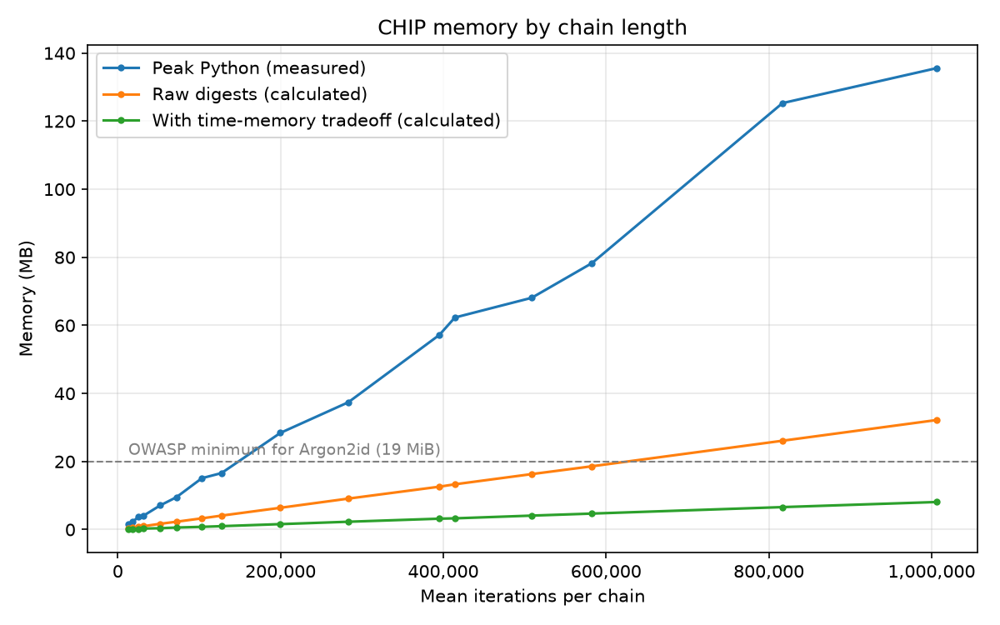

# CHIP: Confounding Hash Iteration for Passwords

Karl Preisner

*Originally developed and written in 2018; revised in 2026.*

▶️ **Live demo:** [karl.preisner.us/chip](https://karl.preisner.us/chip/) runs CHIP in
your browser and shows each salt attempt and collision as it happens.

## Abstract

In 2013, a group of cryptographers launched a public
[Password Hashing Competition](https://www.password-hashing.net) (PHC). It solicited new
password hashing algorithms that, in addition to being secure, have parameters that can
be adjusted to frustrate brute-force password recovery. We describe CHIP, a salted,
iterated hash with adjustable parameters designed with these goals in mind. Together
with the password and its salt, the parameters determine how much computation time and
memory the hash takes, and the number of iterations cannot be known without running the
hash. We measure how the cost grows with each parameter and discuss what this design
does, and does not, protect against, including a time–memory tradeoff that weakens its
memory requirement.

## Introduction

Brute-force password recovery means running the password hash on a large space of
candidate passwords. Message digest algorithms, upon which many password hashes are
built, are designed to be fast. To make each password hash more expensive to compute, the
traditional approach has been to require many iterations of the message digest.

The PHC proposals share a common theme: the ability to control both the time and the
memory needed to compute a password hash. They use three approaches, often together:

- **Require more memory.** This makes the hash harder to implement on processors with
  limited on-chip memory, such as GPUs (graphics processing units).
- **Require more iterations.** This increases the computation time.
- **Make the computation time depend on the input.** This reduces the gains from
  parallel hardware that processes many guesses in lockstep, since threads that finish
  early sit idle while they wait for the slowest one.

CHIP uses all three, though not all to the same effect (see
[Security discussion and limitations](#security-discussion-and-limitations)). While many
PHC proposals design entirely new hashing algorithms, CHIP builds on an existing,
well-studied hash function and applies it in a way that adds memory and input-dependent
cost.

## How CHIP works

CHIP uses a standard hash function: SHA-256 by default, though any fixed-size hash
can be substituted (the implementation supports 12 from Python's `hashlib`, including
MD5, SHA-512, SHA-3, and BLAKE2). For a password $P$ and a random salt $S$, CHIP
computes the hash recursively:

$$D_1 = H(S \,\|\, P), \quad D_2 = H(D_1), \quad \ldots, \quad D_i = H(D_{i-1})$$

We call $D_1, D_2, \ldots$ the *D-sequence*. Let $L_i$ be the low-order $b$ bits of
$D_i$, and call $L_1, L_2, \ldots$ the *L-sequence*. (When a collision occurs, described
below, $D_i$ is perturbed before the next digest is computed from it.)

Because hash outputs are effectively random, we do not expect repeated values in the
D-sequence. However, because of the birthday paradox, we expect to see duplicate values
in the L-sequence after approximately

$$\sqrt{2^b} = 2^{b/2}$$

iterations, because this is when the number of pairs in the L-sequence approaches the
number of possible $b$-bit values. More precisely, the probability of a duplicate passes
one half after about $1.18 \cdot 2^{b/2}$ iterations, and the expected wait for the first
duplicate is $\sqrt{\frac{\pi}{2} \cdot 2^b} \approx 1.25 \cdot 2^{b/2}$ iterations, which
matches our measurements (about 81,000 at $b = 32$). See the
[birthday problem](https://en.wikipedia.org/wiki/Birthday_problem#Average_number_of_people_to_get_at_least_one_shared_birthday)
for the derivation.

CHIP counts these repeats (*collisions*) and stops after $C$ of them, a second
parameter. If it stops after $T$ iterations, it has seen $T - C$ distinct $b$-bit
values. Together, $b$ and $C$ give probabilistic control over the expected number of
iterations.

Detecting collisions requires storing the L-sequence. CHIP uses a hash table, which
has $O(1)$ lookup and insertion, the only two operations it needs.

### Perturbation: why the chain needs memory

Imagine someone guesses a password and wants to check it against a stored hash. If
they check each digest $D_i$ against the target as they compute it, they would not
care when the iteration actually stopped. They would only need to run enough
iterations to be fairly sure there had been $C$ collisions, and they would not need to
store the L-sequence at all.

To prevent this, computing the D-sequence must require knowing exactly when each
collision occurred. When $L_i$ matches an earlier $L_j$ ($j < i$), CHIP *perturbs*
$D_i$ by XOR-ing it with $D_j$, the full digest whose low bits it collided with:

$$D_i \leftarrow D_i \oplus D_j$$

Because the perturbation uses the earlier full digest, a hasher must be able to
recover any earlier $D_j$ on demand, not just recognize its low bits. The simplest way
is to store the entire D-sequence: about 200,000 digests of 32 bytes, or about 6.4 MB,
at the defaults. A perturbation that ignored $D_j$ (for example, flipping one bit) would
only require storing the $b$-bit values themselves, one eighth as much at $b = 32$.
Whatever is stored is specific to the password and salt being hashed, so it cannot be
shared between guesses.

Storing every digest is not the only way to recover $D_j$, however. The
[time–memory tradeoff](#security-discussion-and-limitations) below reduces the memory
needed by about four times at the cost of about 1.3% more hashing.

After the last collision, CHIP hashes once more so the final perturbation affects the
output.

### Salts and bounds on the iteration count

The number of iterations varies a lot between inputs. With $b = 32$ and $C = 5$, a
chain takes about 200,000 iterations on average, with a standard deviation of about
45,000. For some password and salt combinations, an impractically large number of
iterations could be needed.

To bound this, CHIP prepends a random 128-bit salt to the password. If a salt produces
a chain longer than an upper bound, CHIP rejects it, picks a new random salt, and
starts over with fresh state. An optional lower bound (off by default) works the same
way: it rejects salts whose chain finishes too quickly, so no password ends up with an
unusually cheap hash. As with other salted hashes, the salt is stored as part of the
result:

```
function chip_hash(password, b, C, min_iterations, max_iterations):
    # H is the chosen hash function (SHA-256 by default)
    repeat:                                   # retry with a new salt if out of bounds
        salt = 16 random bytes
        h = salt || password
        seen = {}                             # low b bits -> full digest
        collisions = 0
        iterations = 0
        while collisions < C and iterations < max_iterations:
            h = H(h)
            iterations += 1
            key = low_bits(h, b)
            if key in seen:
                collisions += 1
                h = h XOR seen[key]           # perturb with the earlier digest
            else:
                seen[key] = h
        if collisions == C and min_iterations <= iterations <= max_iterations:
            return encode(salt, H(h))         # final hash uses the last perturbation
```

The result is a self-describing string recording every parameter and the salt, so it
can be verified later with nothing but the password:

```
$chip$h=sha256,b=32,c=5,min=0,max=250000$<salt>$<hash>
```

The upper bound trades cost for retries. With the default bound of 250,000 iterations
(about one standard deviation above the mean), about 15% of salts are rejected, so a
hash takes about 1.2 attempts on average. A bound at the mean would reject about half
of all salts.

## Parameters and cost

To measure how the cost depends on $b$ and $C$, we ran CHIP without an upper bound on
1,000 random inputs for every combination of $b$ from 1 to 32 and $C$ from 1 to 20.


Increasing $b$ by one doubles the pool of possible values, so the expected number of
iterations grows by a factor of about $\sqrt{2} \approx 1.41$, in line with the
birthday bound.


As $C$ increases, the number of iterations grows, but at a decreasing rate: each
collision arrives sooner than the last, because more values have already been seen.

The full tables of means and standard deviations are in
[`benchmarks/results/iterations.md`](../benchmarks/results/iterations.md). At the
defaults ($b = 32$, $C = 5$, SHA-256):

| Measure | Value |
|---|---|
| Mean iterations per chain | about 200,000 (standard deviation about 45,000) |
| Salts rejected by the default upper bound (250,000, about mean + 1σ) | about 15% |
| Attempts per hash, including retries | about 1.2 |
| Iterations per hash, including retries | about 235,000 |
| Peak memory, this Python implementation (measured) | about 28 MB |
| Memory for the raw digests alone, 32 bytes each (calculated) | about 6.4 MB |
| Memory with the time–memory tradeoff below (calculated) | about 1.6 MB |
| Time per hash, this Python implementation | about 0.2 s |

These defaults were chosen so that a hash takes a fraction of a second in this Python
implementation, which keeps the examples and benchmarks quick. They are illustrative,
not a deployment recommendation; the next section compares them with current guidance.
Whatever $b$ and $C$ are used, an upper bound between the mean and one standard
deviation above it keeps retries modest.

Memory grows with the number of iterations. The chart below covers $b$ from 24 to 34
and $C$ from 5 to 30, 100 chains each; the full table is in
[`benchmarks/results/memory.md`](../benchmarks/results/memory.md).



## Security discussion and limitations

CHIP makes each guess cost time and memory, and makes that cost vary from guess to
guess. It does not make brute-force recovery impossible, and some of its effects are
smaller than they first appear:

- **Parallelism.** Separate password guesses are independent, so an attacker can
  still run many of them in parallel. Variable run time only hurts hardware that
  processes guesses in lockstep, such as GPUs, and even there an attacker can group
  guesses by run length or abandon any guess that passes the upper bound.
- **Cost asymmetry.** The defender pays for about 1.2 chains per hash because of salt
  retries. An attacker who has the stored hash knows the final salt and pays for
  exactly one chain per guess, which slightly favors the attacker.
- **Time–memory tradeoff.** An attacker does not have to store the D-sequence. It is
  enough to store each $b$-bit value's iteration index, plus one full digest every
  1,000 iterations as a checkpoint: when a collision needs $D_j$, replay the chain from
  the nearest checkpoint before $j$. At the defaults this produces identical hashes
  with about 1.3% more hashing, while cutting the memory needed from about 6.4 MB to
  about 1.6 MB
  ([`benchmarks/time_memory_tradeoff.py`](../benchmarks/time_memory_tradeoff.py)). The
  saving is about four times at every size we measured, because each stored entry
  shrinks from a 32-byte digest to an 8-byte key and index. Argon2 was designed
  specifically to make tradeoffs like this expensive.
- **Memory.** Even without the tradeoff, about 6.4 MB is small next to current
  guidance:
  [OWASP](https://cheatsheetseries.owasp.org/cheatsheets/Password_Storage_Cheat_Sheet.html)
  recommends at least 19 MiB for Argon2id, and RFC 9106 recommends 64 MiB to 2 GiB.
  CHIP's memory is also tied to its run time: memory grows in proportion to the
  iteration count, so a hash can only require more memory by also taking longer. At
  $b = 34$ and $C = 30$, about a million iterations, the digests take about 32 MB and
  the tradeoff about 8 MB
  ([`benchmarks/results/memory.md`](../benchmarks/results/memory.md)). Argon2 and
  scrypt, by contrast, set memory independently of time. An attacker writing in a
  low-level language also avoids the overhead of a Python dictionary, which is why this
  implementation peaks at about 28 MB at the defaults.
- **Iterations.** About 200,000 SHA-256 calls is also modest. OWASP recommends 600,000
  iterations of PBKDF2-HMAC-SHA256, and each of those costs two SHA-256 compressions,
  about six times the hashing work of a CHIP chain at the defaults.
- **Side channels.** The run time and memory access pattern depend on the password,
  which can leak information to an observer on the same machine.
  [Argon2d](https://en.wikipedia.org/wiki/Argon2) has the same weakness, and
  [Argon2id](https://www.rfc-editor.org/rfc/rfc9106#section-1) was designed to reduce
  it.

CHIP is useful for studying these ideas, but for real systems, use Argon2id.

## Related work

- **[PBKDF2](https://www.rfc-editor.org/rfc/rfc8018#section-5.2)** makes hashing
  expensive through iterations alone.
- **[bcrypt](https://www.usenix.org/legacy/events/usenix99/provos/provos.pdf)** adds a
  small, fixed memory requirement (about 4 KB) to its iterations.
- **[scrypt](https://www.rfc-editor.org/rfc/rfc7914)** adds a large, tunable memory
  requirement.
- **[Argon2](https://www.password-hashing.net/)** won the Password Hashing Competition in
  2015. It tunes time, memory, and parallelism separately, and its Argon2id variant is
  the recommended choice ([RFC 9106](https://www.rfc-editor.org/rfc/rfc9106)).

## Conclusions

A brute-force password attack requires running the password hash on a large space of
candidate passwords. CHIP makes each run more expensive by iterating a well-studied
hash function a number of times that depends on the password and salt, and by
requiring the hasher to recover earlier digests on demand. Its parameters, chosen by
the implementer, control the cost, and its results are easy to verify from a
self-describing hash string.

CHIP shows how a few simple ideas (birthday-paradox collisions, perturbation, and salt
retries) combine into a tunable, memory-dependent password hash. In practice, its
memory requirement is tied to its run time and can be cut by about four times through
a time–memory tradeoff, its default iteration count is below current guidance for
iteration-based hashes, and its variable run time is only a partial defense against
parallel attacks. That is why
purpose-built designs like Argon2id remain the right choice in practice.

## Try it

The quickest way is the [live demo](https://karl.preisner.us/chip/), which runs the
same library in your browser with no install.

From a clone of this repository: `HASH_NAME` is the hash function applied on every
iteration, `BITS` is $b$, the number of low bits compared, and `COLLISIONS` is $C$, the
number of repeats that end the chain. `MAX_ITERATIONS` is the upper bound: a salt whose
chain runs longer is rejected, and hashing restarts with a new salt. `chip verify`
prints `match`, and `--verbose` logs each salt attempt and collision as it happens.

```sh
uv sync

PASSWORD=hunter2
HASH_NAME=sha256
BITS=20
COLLISIONS=5
MAX_ITERATIONS=4000

HASH=$(uv run chip hash "$PASSWORD" \
  --hash "$HASH_NAME" \
  --bits "$BITS" \
  --collisions "$COLLISIONS" \
  --max "$MAX_ITERATIONS")
echo "$HASH"
uv run chip verify "$HASH" "$PASSWORD"
uv run chip hash "$PASSWORD" \
  --hash "$HASH_NAME" \
  --bits "$BITS" \
  --collisions "$COLLISIONS" \
  --max "$MAX_ITERATIONS" \
  --verbose
```

See the [README](../README.md) for the Python API.
